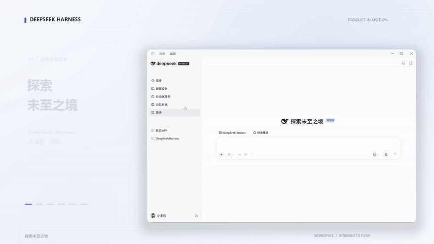

# Minimal UI

[中文](https://github.com/superltmajor-pixel/dsh-minimal-ui/blob/main/README.md) · **English**

A quieter, reading-focused interface for DeepSeek Harness: a tighter sidebar and typography, fewer persistent controls, and the session details you use most moved into the toolbar.



## Philosophy: less is more

This plugin adds no features; it only subtracts. Three principles run through every change:

1. **Fewer persistent things.** Anything expressible by hover, keyboard focus, or a single icon does not get permanent space.
2. **Appear only when needed.** Secondary buttons, hint text, and timestamps stay quiet by default and light up on hover or keyboard focus.
3. **Hierarchy serves reading.** De-emphasize metadata (time, state, counts) so the content is the only focus on the page.

Work can happen in the background, but what reaches the user should be the key, necessary information. So it adjusts elements the official interface already has — no new panels, no new entry points, no new workflows.

## Features

**Reading-first typography**

- Chinese text uses Noto Sans SC instead of Microsoft YaHei; Latin text keeps Segoe UI. Body 15px, code 13px.
- Chinese italics render as upright Kai: Chinese has no true italic, and a synthetic slant distorts the glyphs.
- Tabular figures in tables, first column shrinks to content width; inline code loses the grey pill and keeps only the monospace face.

**A quieter conversation area**

- The content column is fixed to the widest value the host allows, so collapsing the sidebars no longer leaves a large empty band.
- Removes the page-level second scrollbar; scrollbars stay transparent until hovered.
- The content's top edge fades out at the title bar instead of being cut hard; only a very light shadow sits below the title bar.
- Smaller radius and padding on user bubbles; the empty-state hint appears on hover or focus.
- The turn navigator stays tucked outside the right edge and slides out when the pointer approaches.

**A tighter composer**

- The send button loses its blue disc: transparent background, a brand-colored ring on hover.
- The composer sits higher and flatter; the model name keeps only its icon and the permission control becomes an icon.
- The + menu closes on a second click; menu backgrounds are forced opaque so the UI never shows through.

**The toolbar carries the information**

- Three icons in the composer toolbar show generation speed, cache hit rate, and context usage; click for details, and they change color near the limit.
- The four status items in the session header collapse into muted text; agent teams and presets keep only icons, and counts are trimmed to two digits.

**Sidebar and start page**

- Removes the full-width "new session" row at the top of the sidebar (the brand row is itself the entry point).
- The search box, timestamps, and section headers appear on hover; a theme toggle joins the footer, aligned with the account row.
- The start page hides the large compass, folds third-party tool cards into a "more tools" menu with a capped, scrolling height, and unifies tool icons as line art.

**Panels you can close or fold**

- The task panel gains a close button and shows state as dots.
- "Edited N files" folds into a title row by default, expanded by the arrow at its right.
- The last user message after a failure or interruption can be filled back into the composer for editing, without deleting the original or sending it.

**Draggable settings dialog**

- Hold the title strip or the button row at the top of the settings dialog to move the whole window; it stays where you drop it and always remains inside the viewport. Disabled on the full-screen narrow layout.

## Differences from the official interface

The plugin never modifies official source; everything is injected styles and mounted components. By area:

| Area | Official default | Minimal UI |
| --- | --- | --- |
| Typography | Microsoft YaHei + Segoe UI, body 14px | Noto Sans SC + Segoe UI, body 15px |
| Content column | 64% of the conversation area, capped at 920px | The widest value the host allows (column width − 176px, min 640px) |
| Scrollbars | Always visible | Transparent until hover or focus; no second page-level bar |
| Content top edge | Hard cut below the title bar | 12px fade + a very light shadow |
| Composer | Blue disc send button, larger bottom gap | Transparent arrow + brand ring on hover; higher and flatter |
| Toolbar stats | Three always-on text readouts: speed, cache, context | Three icon buttons with details on click |
| Header status | Four status items with text and counts | Icons + muted text, original wording kept as hover tooltips |
| Sidebar | Full-width new-session button, time and search always on | Brand row only; auxiliary info on hover |
| Start page | Centered compass + colorful illustration icons | No compass, line icons, third-party cards folded into a menu |
| Tasks / changes | Panel cannot be closed, file list expanded | Closable; file list folds into a title row |
| Settings dialog | Fixed and centered, cannot be moved | Draggable |

## Compatibility

The current source targets the **DSH 0.2.2-rc.2 Web UI** (also verified on 0.2.2-rc.1) and was developed on the Windows desktop client. The local version has been accepted by its author in their own DSH; the npm package has been verified at the package level (unpacked files match the local build, all six self-checks pass), but interface acceptance in a fresh profile has not been done. The plugin depends on some host-internal layout and CSS class names, so other DSH versions and platforms are unverified; the package declares `>=0.2.2-rc.1 <0.2.3-0`.

Because it changes layout, it may conflict with other plugins that modify the same areas. If you previously installed a local development build, disable it first so two copies do not adjust the same interface.

## Install

From npm (current version `dsh-minimal-ui@0.10.35`):

```sh
dsh plugin --profile web add dsh-minimal-ui
```

Or straight from the GitHub source:

```sh
dsh plugin --profile web add github:superltmajor-pixel/dsh-minimal-ui
```

Replace `web` with the name of the profile you want. Both routes modify the selected profile. The package ships plain JavaScript; no build step is needed.

Enable or disable Minimal UI in that profile's plugin manager. Theme changes, drafts, or the current layout state are not reverted when you disable it. To remove it from the command line:

```sh
dsh plugin --profile web remove dsh-minimal-ui
```

## Development and checks

With Node.js installed in the source directory, run `npm test`. The checks cover package configuration, loader wiring, metrics computation, menu fallbacks, theme toggling, and task-panel behaviour; they run against a simulated host and do not replace verification in the real interface or a clean install.

## Data and permissions

On the client, the plugin reads the current session state and task list the host provides, in order to show stats, tasks, and available actions. To handle editing of failed or interrupted messages it observes message nodes in the page, and on an edit click it reads the displayed text of the last user message and fills it into the host composer. It also reads the header status text to supplement tooltips.

A filled-back draft may be persisted by the host; clicking the theme toggle saves the theme preference through host settings. If initialization fails, the plugin writes an error summary to the browser console, which may include environment details. Normal startup and rendering emit no diagnostic logs.

A source review found no code that makes direct network requests or stores conversation data separately; runtime network traffic has not been verified. Data handling, network behaviour, and logging of the host and other plugins are up to them.

## License

This project is released under the [MIT License](LICENSE). The host software, system fonts, and other independent components it uses at runtime keep their own licenses; this repository does not distribute system fonts.
