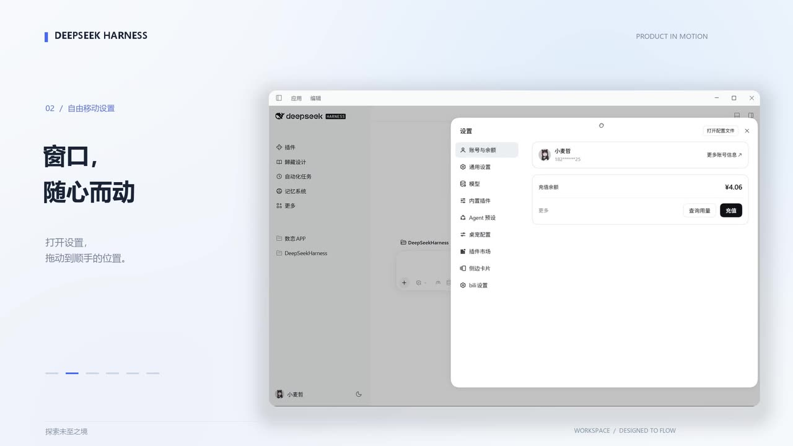

# 极简界面 · Minimal UI

为 DeepSeek Harness 提供更安静、聚焦阅读的界面：收紧侧栏与排版、减少常驻按钮，把常用会话信息集中到工具栏。

[](https://github.com/superltmajor-pixel/dsh-minimal-ui/blob/main/docs/deepseek-harness-motion.mp4)

30 秒演示：探索 → 拖动设置窗口 → 对话 → 命令菜单 → 工具面板 → 收束。点击封面播放（mp4，2.5 MB）。

## 理念：Less is more

这个插件不新增功能，只做减法。三条原则贯穿全部改动：

1. **常驻的东西越少越好**：能用悬停、键盘聚焦或一个图标表达的，就不占固定空间。
2. **只在需要时出现**：辅助按钮、提示文案、时间戳默认安静，指针靠近或键盘聚焦才亮。
3. **层级服务于阅读**：弱化元信息（时间、状态、计数），让正文成为页面上唯一的重点。

后台可以多做，展示给用户的一定是关键且必要的信息。所以它调整的是官方界面已有的元素，不引入新的面板、新的入口或新的工作流。

## 功能

**阅读优先的排版**

- 中文改用 Noto Sans SC 替换微软雅黑，西文保留 Segoe UI；正文 15px、代码 13px。
- 中文斜体改用楷体正体（中文没有真斜体，合成倾斜会把字拉歪）。
- 表格数字等宽、首列收成内容宽；行内代码去掉灰底胶囊，只保留等宽字形。

**更安静的对话区**

- 会话内容列固定为宿主允许的最宽值，两侧栏收起后不再留大片空白。
- 去掉页面级的第二条滚动条；滚动条常态透明，悬停才出现。
- 内容顶边在标题栏交界处做渐隐，滚动时不被硬切；标题栏下方只有一道极轻阴影。
- 用户气泡圆角与内边距收小；空态提示悬停或聚焦才显示。
- 轮次导航条常态收在右边缘外，指针靠近才滑出。

**收紧的输入框**

- 发送按钮去掉蓝色圆盘，改为透明底 + 悬停时画一圈品牌色。
- 输入区上提并压扁；模型名只留图标，权限控件图标化。
- ＋菜单再次点击即收起；菜单背景强制不透明，不透过界面。

**工具栏承载信息**

- 输入工具栏用三个图标显示生成速度、缓存命中率和上下文占用，点开看明细，接近上限时变色提醒。
- 会话标题行的四个状态项压成弱化文字，智能体团队与预设只留图标，计数裁到两位。

**侧栏与开始页**

- 去掉侧栏顶部那条通栏「新会话」（品牌行本身就是新会话入口）。
- 搜索框、时间戳、分区标题悬停才显示；页脚新增主题切换按钮，与账户行对齐。
- 右侧开始页隐藏大罗盘，第三方工具卡收进「更多工具」菜单并限高滚动；工具图标统一成线条风格。

**可关闭、可折叠的面板**

- 任务面板增加关闭按钮，状态用圆点表示。
- 「已编辑 N 个文件」默认折叠成标题行，右上箭头展开。
- 失败或中断的最后一条用户消息可以回填到输入框编辑，不删除原消息、不自动发送。

**可拖动的设置弹窗**

- 按住设置弹窗顶部的标题栏或按钮行即可移动整个窗口，松手停在原处；窗口始终留在可视区域内，窄屏全屏时不启用。

## 与官方界面的差异

插件不修改官方源码，全部通过注入样式和挂载自有组件实现。按区域对照：

| 区域 | 官方默认 | 极简界面 |
| --- | --- | --- |
| 字体 | 微软雅黑 + Segoe UI，正文 14px | Noto Sans SC + Segoe UI，正文 15px |
| 会话内容列 | 对话区宽度的 64%，上限 920px | 宿主允许的最宽值（列宽 − 176px，最小 640px） |
| 滚动条 | 常驻可见 | 常态透明，悬停或聚焦显示；无页面级第二条 |
| 会话顶边 | 内容在标题栏下方硬切 | 12px 渐隐 + 一道极轻阴影 |
| 输入框 | 蓝色圆盘发送键，底部留白较大 | 透明底箭头 + 悬停蓝圈；上提并压扁 |
| 工具条统计 | 速度、缓存、上下文三项常驻文字 | 三个图标按钮，点开看明细 |
| 标题行状态 | 四个状态项带文字与计数 | 图标化 + 弱化文字，原文案挂为悬停提示 |
| 侧栏 | 通栏新会话按钮，时间与搜索常驻 | 只留品牌行入口；辅助信息悬停显示 |
| 开始页 | 居中罗盘 + 彩色插画图标 | 无罗盘，线条图标，第三方卡片收进菜单 |
| 任务 / 更改 | 面板不可关闭，文件列表默认展开 | 可关闭；文件列表折叠成标题行 |
| 设置弹窗 | 固定居中，不能移动 | 可拖动 |

## 兼容性

当前源码针对 **DSH 0.2.2-rc.1 的 Web 界面**制作，开发环境为 Windows 桌面客户端。本地版本的界面已由使用者在自己的 DSH 中验收；npm 包已通过包级安装核验（解包文件与本地一致、六项自检全过），但在全新 profile 中的界面验收仍未进行。插件依赖部分宿主内部布局和 CSS 类名，其他 DSH 版本及平台尚未验证；包的兼容声明目前限定为该版本。

插件会改变界面布局，也可能与修改相同区域的其他插件产生冲突。如果此前安装过本项目的本地开发版，请先禁用旧版，避免两份插件同时调整同一界面。

## 安装

从 npm 安装（当前版本 `dsh-minimal-ui@0.10.34`）：

```sh
dsh plugin --profile web add dsh-minimal-ui
```

也可以直接从 GitHub 源码安装：

```sh
dsh plugin --profile web add github:superltmajor-pixel/dsh-minimal-ui
```

把命令中的 `web` 换成希望安装到的 profile 名称。两种方式都会修改所选 profile。包内直接提供 JavaScript，不需要额外构建。

在所选 profile 的插件管理界面中启用或停用「极简界面」。已经更改的主题、草稿或当前布局状态不会因停用而自动撤销。命令行移除示例：

```sh
dsh plugin --profile web remove dsh-minimal-ui
```

## 开发与检查

在源码目录安装 Node.js 后，可运行 `npm test`。这些检查覆盖包配置、加载接线、统计计算、菜单回退、主题切换和任务面板行为；它们使用模拟宿主，不能替代实际界面和干净安装验证。

## 数据与权限

插件在客户端读取宿主提供的当前会话状态和任务列表，以显示统计、任务和可用操作；为处理失败或中断消息的编辑，它会观察页面中的消息节点，点击编辑时读取最后一条用户消息的显示文本并回填宿主输入框。它也会读取标题栏状态文字，用于补充提示。

回填后的草稿可能由宿主保存；点击主题切换会通过宿主设置保存主题偏好。插件初始化失败时会向浏览器控制台写入错误摘要，日志可能包含环境信息。常规启动和渲染不输出诊断日志。

对插件源码的检查未发现直接发起网络请求或独立持久化会话数据的代码；尚未进行运行时网络流量验证。宿主及其他插件的数据处理、网络行为和日志由它们各自决定。

## 许可证

本项目采用 [MIT License](LICENSE)。运行时调用的宿主软件、系统字体及其他独立组件适用其各自的许可证；本仓库不分发系统字体。

## English

Minimal UI is a reading-focused interface plugin for DeepSeek Harness. It changes nothing the host already offers: it only tightens the layout, quiets persistent controls, and moves frequently used session information into the toolbar. The guiding rule is less is more — anything that can be shown on hover, on keyboard focus, or as a single icon does not get permanent space.

The current source targets the DSH 0.2.2-rc.1 Web UI and was developed on Windows; other versions and platforms have not been verified. It uses host-provided conversation state and tasks, and reads the last displayed user message when the edit action is used. The host may persist drafts and theme changes. No direct network requests or separate conversation storage were found in the plugin source; runtime network traffic has not been checked. See [MIT License](LICENSE).
